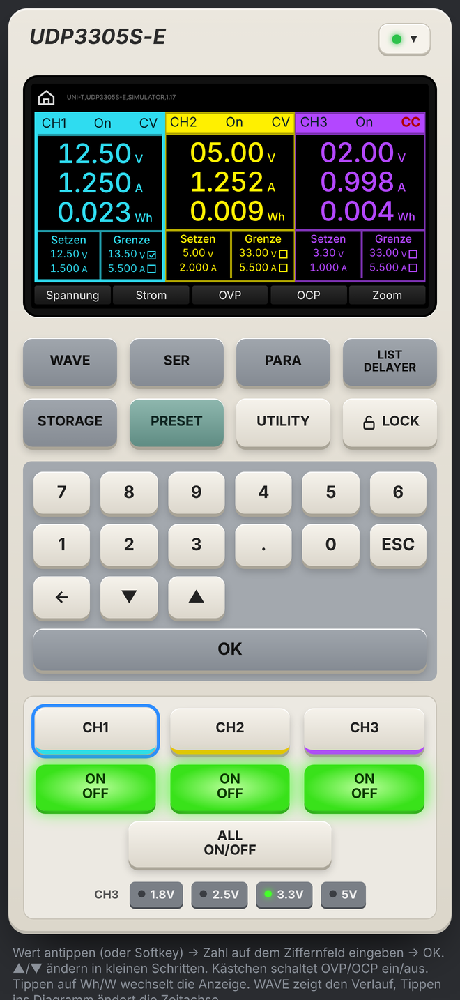
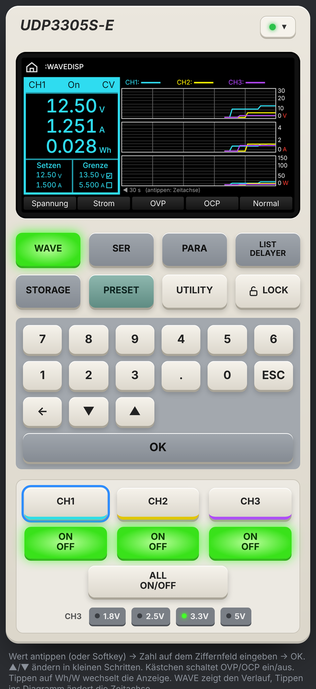
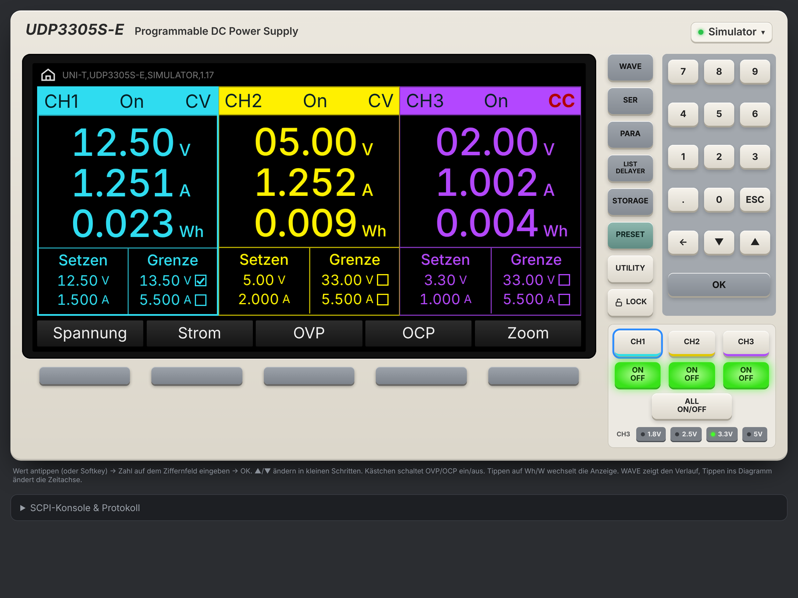

# PSU Control

**English** · [Deutsch](README.de.md)

Remote control for the **UNI-T UDP3305S-E** programmable bench power supply over your local network.
The interface recreates the instrument's front panel – display, soft keys and buttons – on the Mac, iPhone and iPad.


<p align="center">
  
  &nbsp;
  
</p>
<p align="center"></p>

## Download

| Platform | |
|---|---|
| **iPhone / iPad** | **[TestFlight beta](https://testflight.apple.com/join/tYkUeqYG)** · App Store: *coming soon* <!-- APPSTORE_URL --> |
| **Mac** | [Latest release](../../releases/latest) → `PSU-Control-mac.zip` |
| **Source** | this repository (MIT licence) |

> The user interface is currently in **German**. The documentation is available in English and German.

## Features

- Live readings for every channel (V, A, Wh or W), CV/CC indication, outputs on/off individually or all at once
- Set voltage and current, OVP/OCP limits with enable switches
- Independent, **series** and **parallel** mode, CH3 quick select 1.8 / 2.5 / 3.3 / 5 V
- **WAVE** – voltage, current and power history of all channels (30 s / 2 min / 10 min)
- **LIST** – voltage/current sequences up to 2048 steps: sine, pulse, ramp, staircase, exponential or your own table, with preview, upload, start/stop and progress
- **DELAYER** – timed output on/off sequences with optional stop condition (V, A or W above/below a limit)
- **PRESET** P1–P5 and **STORAGE** 1–10
- **UTILITY** – beeper, brightness, key lock and remote lock, LAN (DHCP/IP/mask/gateway), RS-232, error queue, self-test, factory reset
- Network search for instruments, manual IP, recently used devices
- Built-in **simulator** – try everything without an instrument
- SCPI console for any command from the programming manual

| | |
|---|---|
|  |  |
|  |  |

## Documentation

- 📘 [User manual (English)](docs/MANUAL.en.md)
- 📗 [Benutzerhandbuch (Deutsch)](docs/HANDBUCH.de.md)
- 🔒 [Privacy policy](PRIVACY.md)
- 📝 [Changelog](CHANGELOG.md)

## Requirements

- UNI-T **UDP3305S-E** (other UDP3000S models use the same SCPI commands and will most likely work) with **LAN** enabled
- **iPhone / iPad:** iOS / iPadOS 16 or later
- **Mac:** macOS 10.15 or later and Python 3 (the app offers to install Apple's free Command Line Tools if missing)
- The instrument and the Mac/iPhone must be on the same network. The app talks SCPI over TCP port **5025**.

## How it works

```
                      ┌────────────────────────────┐
   web/index.html  ───┤  same UI on all platforms  │
                      └──────────────┬─────────────┘
                     fetch('/api/…') │
             ┌───────────────────────┴───────────────────────┐
     Mac:  mac/udp3305.py (local web server)        iOS: web/ios-bridge.js
           Python standard library only                  + Swift (WKWebView, sockets)
             └───────────────────────┬───────────────────────┘
                                     │ SCPI over TCP :5025
                              UNI-T UDP3305S-E
```

The Mac app and the iOS app offer the same `/api/…` endpoints, so `web/index.html` runs unchanged on both.

## Project layout

```
web/index.html            Shared user interface (HTML/CSS/JS, no libraries)
web/ios-bridge.js         Device logic for iOS (answers /api/… inside the app)
mac/udp3305.py            Mac server: serves the UI, talks SCPI (Python standard library only)
mac/AppTemplate/          Info.plist, launcher and icon of the Mac app
mac/build-mac-app.sh      Builds dist/PSU Control.app and the ZIP file
ios/PSUControl.xcodeproj  Xcode project of the iOS/iPadOS app
ios/PSUControl/           Swift: WebView, native bridge, TCP socket, network scan
ios/project.yml           Alternative project description for XcodeGen
tools/fake_device.py      Simulated instrument on the network (for testing)
tools/publish-github.sh   Helper to create the GitHub repository
docs/                     Manuals, screenshots, App Store texts
```

## Building

### Mac app
```bash
./mac/build-mac-app.sh        # -> dist/PSU Control.app and dist/PSU Control.zip
```
Or run it directly without building the app: `python3 mac/udp3305.py [--host IP] [--lan] [--sim]`.

The app is not notarised by Apple. On first launch: macOS 15+ → *System Settings → Privacy & Security → Open Anyway*. On older versions, right-click the app → *Open*.

### iOS / iPadOS app
1. Open `ios/PSUControl.xcodeproj` in Xcode 15 or later.
2. Target **PSUControl** → *Signing & Capabilities* → select your **team**. If needed, change the bundle identifier `de.1mhz.psucontrol` to one of your own.
3. Choose your iPhone/iPad and press **Run**. Allow access to the **local network** when asked.

For App Store / TestFlight: *Product → Archive → Distribute App*. Ready-made store texts are in [`docs/appstore/`](docs/appstore/).

### Testing without an instrument
- In the app: *Connection → Simulator (without device)*.
- Over the network: `python3 tools/fake_device.py -v` on your Mac, then search the network in the app or enter the Mac's IP. The simulated instrument behaves like the real one over TCP, including LIST and DELAYER.

## Limits of the instrument

- The shortest LIST step is **0.1 s**. A 20-point sine therefore runs at 0.5 Hz at most. This is for slow sequences such as battery curves, brown-out tests, soft start or power cycling, not a replacement for a signal generator.
- Only positive voltages (0–30 V per channel). The supply can source but not sink current, so falling edges at light load are slower than programmed.
- There is no SCPI command for the instrument's own WAVE screen. The app draws the curves from its own measurements (2 per second).
- The energy counter (Wh) is calculated by the app from measured power, because the instrument does not report it over SCPI.

## Contributing

Bug reports and pull requests are welcome – see [CONTRIBUTING.md](CONTRIBUTING.md).

## Disclaimer

*UNI-T* and *UDP3305S-E* are trademarks of Uni-Trend Technology (China) Co., Ltd. This project is independent and not affiliated with or endorsed by UNI-T. The names are used only to identify the supported instrument.
The SCPI commands follow UNI-T's *UDP3000S Series Programming Manual*, which is not part of this repository.
Use at your own risk – a power supply can damage connected circuits. Set OVP and OCP sensibly.

## Licence

[MIT](LICENSE) © 2026 Martin Oswald
