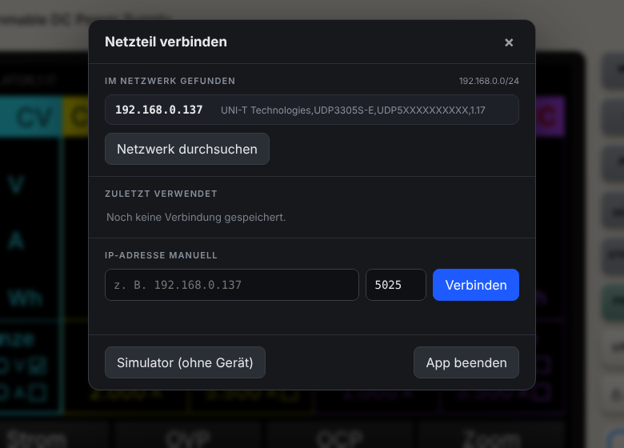
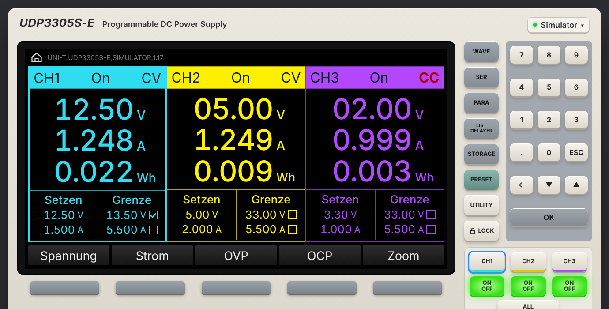
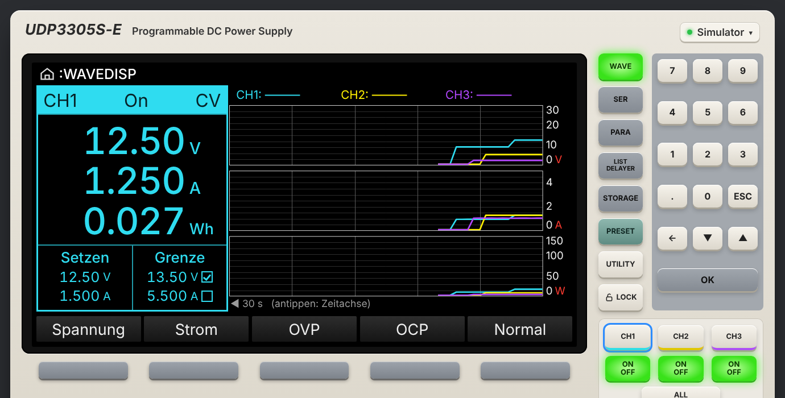
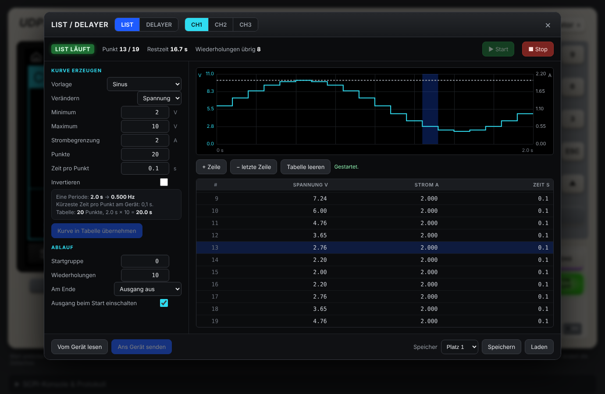
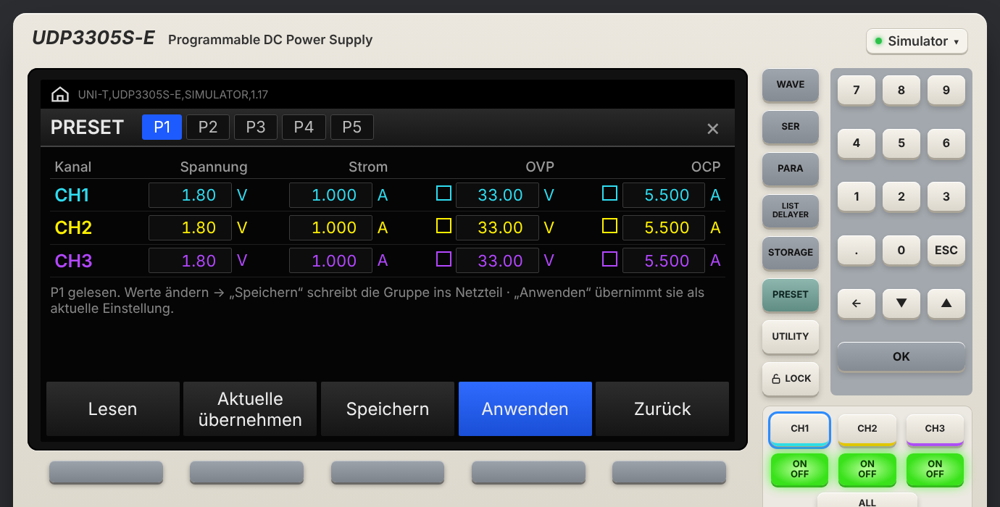
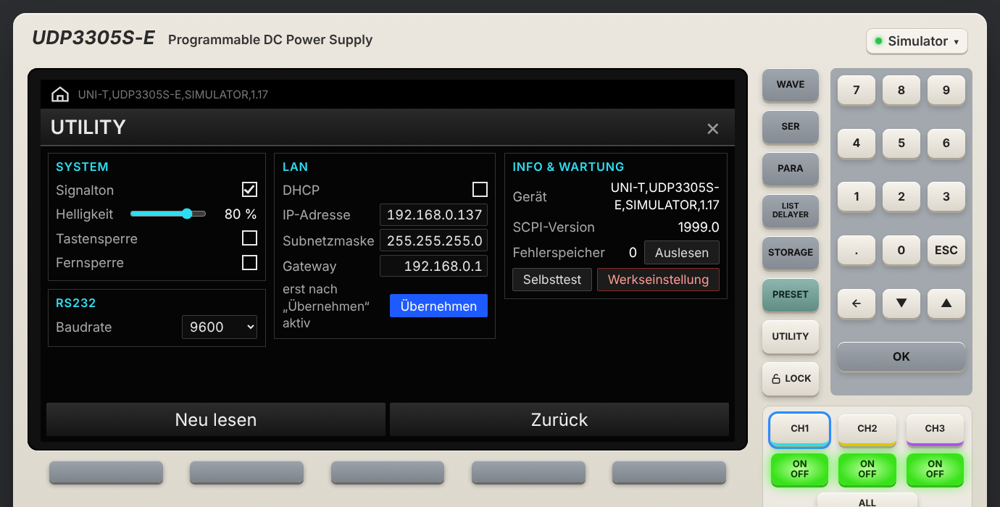

# PSU Control – Benutzerhandbuch

[English](MANUAL.en.md) · **Deutsch**

PSU Control steuert das Labornetzteil UNI-T UDP3305S-E über das lokale Netzwerk. Es gibt PSU Control als Mac-App und als App für iPhone und iPad. Beide haben dieselbe Oberfläche, die die Gerätefront nachbildet.

## Inhalt
1. [Netzteil vorbereiten](#1-netzteil-vorbereiten)
2. [Installation](#2-installation)
3. [Verbinden](#3-verbinden)
4. [Die Hauptansicht](#4-die-hauptansicht)
5. [Werte eingeben](#5-werte-eingeben)
6. [Tasten](#6-tasten)
7. [WAVE – Kurvenansicht](#7-wave--kurvenansicht)
8. [LIST – Spannungs- und Stromverläufe](#8-list--spannungs--und-stromverläufe)
9. [DELAYER – Ein/Aus nach Zeitplan](#9-delayer--einaus-nach-zeitplan)
10. [PRESET](#10-preset)
11. [STORAGE](#11-storage)
12. [UTILITY](#12-utility)
13. [SCPI-Konsole](#13-scpi-konsole)
14. [Simulator und Test-Gerät](#14-simulator-und-test-gerät)
15. [Grenzen und Wissenswertes](#15-grenzen-und-wissenswertes)
16. [Fehlersuche](#16-fehlersuche)
17. [Dateien und Einstellungen](#17-dateien-und-einstellungen)

---

## 1. Netzteil vorbereiten

1. Das UDP3305S-E per Netzwerkkabel mit Router oder Switch verbinden.
2. Am Gerät **UTILITY → Schnittstelle / LAN** öffnen und DHCP einschalten oder eine feste IP-Adresse eintragen. Eine feste Adresse ist empfehlenswert, dann findet die App das Gerät immer unter derselben Adresse.
3. Die am Gerät angezeigte IP-Adresse notieren, z. B. `192.168.0.137`.

Die App spricht SCPI über **TCP-Port 5025**. Schließe die UNI-T-PC-Software, bevor du PSU Control benutzt, sonst kann die Verbindung belegt sein.

## 2. Installation

### iPhone / iPad
**PSU Control** über die [TestFlight-Beta](https://testflight.apple.com/join/tYkUeqYG) installieren (vorher die kostenlose App *TestFlight* aus dem App Store laden), später aus dem App Store. Voraussetzung ist iOS / iPadOS 16 oder neuer.

Beim ersten Start fragt iOS nach dem Zugriff auf das **lokale Netzwerk**. Tippe auf **Erlauben**, ohne diese Erlaubnis erreicht die App das Netzteil nicht. Ändern lässt sich das später unter *Einstellungen → Datenschutz & Sicherheit → Lokales Netzwerk*.

### Mac
1. `PSU Control.zip` von der [Release-Seite](../../../releases/latest) laden und entpacken.
2. **PSU Control.app** in den Ordner *Programme* ziehen.
3. Die App ist nicht von Apple beglaubigt, deshalb blockiert macOS den ersten Start:
   * macOS 15 und neuer: Öffnen versuchen, dann *Systemeinstellungen → Datenschutz & Sicherheit* → **Trotzdem öffnen**.
   * Ältere Versionen: Rechtsklick auf die App → **Öffnen** → **Öffnen**.
4. PSU Control braucht **Python 3**. Fehlt es, bietet die App die Installation der kostenlosen Apple *Command Line Tools* an. Danach die App erneut öffnen.
5. Fragt macOS nach dem Zugriff auf das lokale Netzwerk: erlauben.

Die Mac-App öffnet die Oberfläche im Standard-Browser unter `http://localhost:8080`. Ist der Port belegt, nimmt sie den nächsten freien. Wird die App ein zweites Mal geöffnet, öffnet sich nur ein neues Browserfenster. Beenden: **Verbindung → App beenden**.

## 3. Verbinden

Klicke oben rechts auf den Verbindungsknopf (grüner Punkt = verbunden, rot = nicht verbunden) oder auf das LAN-Symbol im Display. Es erscheint **Netzteil verbinden**. Beim ersten Start öffnet sich der Dialog von selbst.

- **Netzwerk durchsuchen:** Die App sucht im eigenen Netz (/24) nach Geräten mit offenem Port 5025 und zeigt deren Kennung (`*IDN?`). UNI-T-Geräte stehen oben. Ein Klick verbindet.
- **Zuletzt verwendet:** die letzten acht Geräte. Beim nächsten Start verbindet sich die App automatisch mit dem zuletzt benutzten. ✕ entfernt einen Eintrag.
- **IP-Adresse manuell:** Adresse (und Port, normalerweise 5025) eintragen und **Verbinden** drücken.
- **Simulator (ohne Gerät):** ein eingebautes, virtuelles UDP3305S-E zum Ausprobieren.

## 4. Die Hauptansicht

Das Display zeigt eine Spalte pro Kanal, in den Farben des Geräts: **CH1 türkis, CH2 gelb, CH3 lila**. Im Seriell- oder Parallelbetrieb erscheinen der zusammengeschaltete Kanal (SER/PARA) und CH3.

Jede Spalte enthält:
- **Kopfzeile:** Kanal, **On/Off**, **CV/CC**. Bei eingeschaltetem Ausgang ist die Kopfzeile farbig hinterlegt. CC (Konstantstrom, die Strombegrenzung greift) erscheint rot.
- **Messwerte:** gemessene Spannung (V), Strom (A) und Energie (Wh). Ein Klick auf Wh schaltet auf Leistung (W) um und zurück. Bei ausgeschalteten Kanälen sind die Werte gedimmt.
- **Setzen:** Sollwerte für Spannung und Strom.
- **Grenze:** OVP- (Überspannungs-) und OCP- (Überstrom-) Schutzwerte. Das Kästchen daneben schaltet den Schutz ein oder aus.

Der ausgewählte Kanal hat einen farbigen Rahmen. Auswählen per Klick auf die Spalte oder mit den Tasten **CH1/CH2/CH3**.

Die Softkeys unter dem Display, **Spannung**, **Strom**, **OVP** und **OCP**, wählen das passende Feld des ausgewählten Kanals. **Zoom** zeigt nur den ausgewählten Kanal in großen Ziffern.

## 5. Werte eingeben

1. Wert anklicken oder antippen bzw. Softkey drücken. Das Feld bekommt einen weißen Rahmen.
2. Die Zahl über die Tastatur oder das Ziffernfeld eingeben. Die Eingabe wird wie am Gerät blau markiert.
3. Mit **Enter** oder **OK** bestätigen. **ESC** bricht ab.

Weitere Möglichkeiten:
- **Mausrad** über einem Wert wirkt wie der Drehknopf: Spannung ±0,1 V, Strom ±0,01 A. Mit gedrückter **⌥ (Wahltaste)** geht es in feinen Schritten von 0,01 V / 0,001 A.
- **▲ / ▼** auf dem Ziffernfeld oder die Pfeiltasten ändern den gewählten Wert in kleinen Schritten.
- Die App sendet Änderungen sofort ans Gerät und liest den Wert danach zurück. Lehnt das Gerät einen Wert ab, erscheint unten rechts eine Meldung.

## 6. Tasten

| Taste | Funktion |
|---|---|
| **WAVE** | Kurvenansicht (siehe 7). Die Taste leuchtet grün, solange sie aktiv ist. |
| **SER / PARA** | Seriell- oder Parallelbetrieb. Erneutes Drücken schaltet zurück auf unabhängig. Vorher die Ausgänge ausschalten. |
| **LIST / DELAYER** | Abläufe (siehe 8 und 9). |
| **STORAGE** | Einstellungen auf Platz 1–10 speichern oder laden (siehe 11). Erneut drücken schließt. |
| **PRESET** | Preset-Gruppen P1–P5 (siehe 10). Erneut drücken führt zurück zur Hauptansicht. |
| **UTILITY** | Systemeinstellungen (siehe 12). Erneut drücken führt zurück zur Hauptansicht. |
| **LOCK** | Schaltet die Tastensperre am Netzteil ein und aus. Gesperrt: Schloss geschlossen, „LOCK“ leuchtet grün wie am Gerät. Entsperren hebt auch eine Fernsperre auf. Eine direkt am Gerät gesetzte Sperre zeigt die App nach wenigen Sekunden an. |
| **CH1 / CH2 / CH3** | Kanal auswählen. |
| **ON/OFF** | Ausgang des Kanals schalten. Leuchtet grün, wenn er eingeschaltet ist. |
| **ALL ON/OFF** | Alle Ausgänge ein, oder alle aus, wenn einer an ist. |
| **CH3 1.8V … 5V** | Schnellwahl der CH3-Spannung. Der aktive Wert leuchtet. |
| **Ziffernfeld, ESC, ←, ▲▼, OK** | Werteingabe. |

## 7. WAVE – Kurvenansicht

**WAVE** schaltet auf die Kurvenansicht, nachgebildet der Anzeige *:WAVEDISP* am Gerät.
- **Links:** der ausgewählte Kanal mit Messwerten und Einstellungen. Wechseln mit CH1/CH2/CH3.
- **Rechts:** drei Diagramme für Spannung (0–30 V), Strom (0–5 A) und Leistung (0–150 W) aller Kanäle. Im Seriell-/Parallelbetrieb passen sich die Achsen an (60 V / 10 A).
- **Klick ins Diagramm** wechselt die Zeitachse: **30 s → 2 min → 10 min**.
- **Normal** (5. Softkey) oder erneut WAVE führt zurück zur normalen Ansicht.

Die Kurven entstehen aus den Messungen der App, zweimal pro Sekunde. Sie beginnen, wenn die App geöffnet wird. Ereignisse unter etwa einer halben Sekunde erscheinen eventuell nicht.

## 8. LIST – Spannungs- und Stromverläufe

Mit LIST spielt das Netzteil selbstständig einen Ablauf mit bis zu **2048 Schritten** ab. Jeder Schritt hat eine **Spannung**, eine **Strombegrenzung** und eine **Dauer**. Öffnen mit **LIST / DELAYER**, oben den Reiter **LIST** und den Kanal wählen.

### Kurve erzeugen
Links unter **Kurve erzeugen**:

| Feld | Bedeutung |
|---|---|
| **Vorlage** | Sinus, Puls/Rechteck, Rampe/Dreieck, Treppe aufwärts/abwärts/auf und ab, exponentiell steigend/fallend |
| **Verändern** | Ob die Vorlage die **Spannung** oder den **Strom** formt |
| **Minimum / Maximum** | Bereich der Kurve |
| **Strombegrenzung / Spannung** | Der feste andere Wert: Strombegrenzung, wenn die Spannung geformt wird, sonst die Spannung |
| **Punkte** | Anzahl der Schritte (2–2048) |
| **Zeit pro Punkt** | Dauer jedes Schritts, mindestens 0,1 s |
| **Invertieren** | Sinus, Puls und Rampe umgedreht |
| **Tastverhältnis** | Puls: Anteil der Periode auf Maximum |
| **Symmetrie** | Rampe: 100 % = steigender Sägezahn, 0 % = fallend, 50 % = Dreieck |
| **Exponent** | Exponential: Steilheit 0–10 (0 = linear) |

Der Infokasten zeigt **Periode und Frequenz** sowie die Gesamtdauer. **Kurve in Tabelle übernehmen** füllt die Tabelle rechts. Dort kannst du jeden Wert ändern, mit **+ Zeile** Zeilen anfügen oder mit **− letzte Zeile** entfernen.

### Ablauf
Unter **Ablauf**:
- **Startgruppe:** ab welcher Stelle im Gerätespeicher (0–2047) die Tabelle liegt
- **Wiederholungen:** 1–99.999
- **Am Ende:** Ausgang aus, oder letzten Wert halten
- **Ausgang beim Start einschalten:** empfohlen

### Übertragen und starten
1. **Ans Gerät senden** schreibt Tabelle und Ablauf ins Netzteil. Lange Tabellen dauern einige Sekunden, der Fortschritt wird angezeigt.
2. **▶ Start** spielt den Ablauf ab. Die Statuszeile zeigt **Punkt**, **Restzeit** und **Wiederholungen übrig**. Die aktuelle Zeile ist in Tabelle und Vorschau markiert.
3. **■ Stop** beendet vorzeitig.

**Vom Gerät lesen** holt den im Netzteil gespeicherten Ablauf in die Tabelle. Während ein Ablauf läuft, nimmt das Gerät keine Änderungen an.

### Beispiel: Unterspannungstest einer 5-V-Schaltung
Vorlage *Treppe auf und ab*, Verändern *Spannung*, Minimum 4,2 V, Maximum 5,0 V, Strombegrenzung 1 A, 9 Punkte, 2 s pro Punkt, 3 Wiederholungen. Die Schaltung sieht dann dreimal hintereinander 5,0 → 4,2 → 5,0 V in Schritten von 0,2 V.

## 9. DELAYER – Ein/Aus nach Zeitplan

Hier bleibt die Spannung wie eingestellt, der Ablauf schaltet den **Ausgang** ein und aus. Bis zu **2048 Schritte**, jeder mit Zustand (ein/aus) und Dauer. Öffnen über den Reiter **DELAYER**.

**Ablauf erzeugen:**
- **Ein/Aus im Wechsel** (beginnt mit Ein oder Aus): feste Ein-Zeit und Aus-Zeit
- **Zeiten steigend / fallend:** abwechselnd ein/aus, die Dauer beginnt bei der *Startzeit* und ändert sich jedes Mal um den *Schritt*

Einstellungen unter **Ablauf:** Startgruppe, Wiederholungen, Zustand am Ende (Ausgang aus / ein / letzten Zustand halten) und optional **Abbruch wenn**: Spannung, Strom oder Leistung über oder unter einem Grenzwert. Zum Beispiel stoppt *Strom > 3 A* den Test, wenn die Schaltung zu viel zieht.

Übertragen und Starten funktionieren wie bei LIST. Typische Anwendungen: Ein/Aus-Dauertests, Einschaltreihenfolge mehrerer Kanäle (je Kanal ein Delayer), Einschaltverhalten einer Schaltung prüfen.

## 10. PRESET

Das Netzteil hat fünf Preset-Gruppen **P1–P5**. Jede enthält Spannung, Strom, OVP und OCP aller Kanäle. Gruppe über die Reiter wählen:
- **Lesen:** Gruppe aus dem Gerät holen
- **Aktuelle übernehmen:** die momentanen Einstellungen eintragen
- **Speichern:** Gruppe ins Gerät schreiben
- **Anwenden:** Gruppe als aktuelle Einstellung übernehmen

## 11. STORAGE

**STORAGE** speichert die komplette aktuelle Einstellung auf einem von zehn Plätzen im Gerät (**Speichern**) oder lädt sie zurück (**Laden**). LIST und DELAYER haben im LIST/DELAYER-Fenster eigene zehn Speicherplätze.

## 12. UTILITY

- **System:** Signalton, Display-Helligkeit, Tastensperre, Fernsperre. Die Fernsperre lässt sich nur per Befehl oder durch Neustart des Geräts lösen. Die Taste **LOCK** in der App zeigt den Sperrzustand und hebt beide Sperren auf.
- **LAN:** DHCP, IP-Adresse, Subnetzmaske, Gateway. Änderungen werden erst mit **Übernehmen** aktiv. Ändert sich die IP, verbindet sich die App nach einigen Sekunden mit der neuen Adresse. Bei DHCP öffnet sich stattdessen die Netzwerksuche.
- **RS232:** Baudrate.
- **Info & Wartung:** Gerätekennung, SCPI-Version, **Fehlerspeicher** mit Anzahl und **Auslesen**, **Selbsttest**, **Werkseinstellung** (mit doppelter Rückfrage).

## 13. SCPI-Konsole

Ganz unten auf der Seite öffnet **SCPI-Konsole & Protokoll** eine Konsole. Dort kannst du jeden Befehl aus der *UDP3000S Programming Manual* eingeben, z. B. `*IDN?` oder `:MEASure:ALL? CH1`. Bei Abfragen (mit `?`) erscheint die Antwort, bei anderen Befehlen eine eventuelle Fehlermeldung des Geräts. ↑/↓ blättern durch die bisherigen Befehle. Das Protokoll listet außerdem alle Änderungen, die die App sendet.

## 14. Simulator und Test-Gerät

- **Simulator:** *Verbindung → Simulator (ohne Gerät)*. Ein virtuelles UDP3305S-E mit Lastwiderständen an den Ausgängen (CH1 10 Ω, CH2 4 Ω, CH3 2 Ω). Er beherrscht alle Funktionen einschließlich LIST und DELAYER.
- **Test-Gerät im Netzwerk:** `python3 tools/fake_device.py -v` (aus dem Quellcode) startet auf Port 5025 des Macs ein simuliertes Netzteil. Vom iPhone oder Mac verbindest du dich damit wie mit einem echten Gerät. `-v` zeigt jeden Befehl an.

## 15. Grenzen und Wissenswertes

- Das Gerät erlaubt bei LIST mindestens **0,1 s** pro Schritt. Ein Sinus mit 20 Punkten hat also mindestens 2 s Periode (0,5 Hz). LIST ist für langsame Vorgänge gedacht, nicht als Signalgenerator.
- Nur positive Spannungen von 0–30 V (CH3 0–6 V). Das Netzteil kann Strom liefern, aber nicht aufnehmen. Bei kleiner Last fallen Spannungen deshalb langsamer als programmiert.
- Die App liest die Messwerte zweimal pro Sekunde. Den **Wh**-Zähler berechnet die App aus der gemessenen Leistung, er beginnt beim Einschalten des Ausgangs neu. Er kann daher leicht von der Anzeige am Gerät abweichen.
- Eingabegrenzen der App: CH1/CH2 32 V / 5,2 A, CH3 6,2 V / 3,2 A, SER 64 V, PARA 10,4 A. Das Gerät begrenzt zusätzlich selbst.
- Bei aktiver Tastensperre funktionieren am Gerät nur noch die ON/OFF-Tasten. Die App behält die volle Kontrolle. **LOCK** in der App hebt die Sperre auf.

## 16. Fehlersuche

| Problem | Lösung |
|---|---|
| Netzwerksuche findet nichts | Ist LAN am Gerät aktiv, mit einer IP im selben Netz? Sind beide im selben Netz (kein Gäste-WLAN)? iPhone: Zugriff auf das lokale Netzwerk in den Einstellungen erlauben. Mac: Zugriff auf das lokale Netzwerk erlauben. |
| *nicht erreichbar* | IP am Gerät prüfen. UNI-T-PC-Software schließen. Port 5025 prüfen. |
| Werte werden nicht übernommen | Meldung des Geräts (unten rechts) und den Fehlerspeicher in UTILITY prüfen. Liegt der Wert über OVP/OCP? Läuft gerade ein LIST/DELAYER-Ablauf? |
| Mac: App öffnet sich nicht | *Systemeinstellungen → Datenschutz & Sicherheit → Trotzdem öffnen*. Fehlt Python 3? App erneut öffnen und die Installation bestätigen. |
| Mac: Browser zeigt „Mac-Server läuft nicht“ | App erneut starten. Protokoll: `~/Library/Logs/PSU Control.log` |
| Tasten am Gerät gesperrt | **LOCK** in der App drücken oder LOCK am Gerät lange drücken. |

## 17. Dateien und Einstellungen

| | Mac | iPhone / iPad |
|---|---|---|
| Einstellungen (zuletzt verwendete Geräte) | `~/Library/Application Support/PSU Control/config.json` | in der App gespeichert |
| Protokoll | `~/Library/Logs/PSU Control.log` | – |

PSU Control sendet keine Daten ins Internet und enthält kein Tracking, siehe [Datenschutz](../PRIVACY.md).

---
*UNI-T und UDP3305S-E sind Marken der Uni-Trend Technology (China) Co., Ltd. PSU Control ist ein unabhängiges Projekt.*
